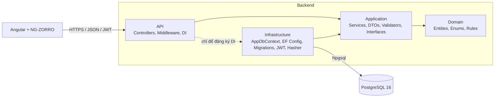

# Architecture Overview

Clean Architecture cho Backend; Angular theo feature cho Frontend. Quyết định và lý do: [adr.md](adr.md).

## Sơ đồ tổng thể



## Tham chiếu giữa các project

| Project | Được tham chiếu tới | Package chính |
|---|---|---|
| Domain | không có | không |
| Application | Domain | FluentValidation, `Microsoft.EntityFrameworkCore` (chỉ để dùng `DbSet<T>` và LINQ async trong `IAppDbContext`) |
| Infrastructure | Application | Npgsql.EntityFrameworkCore.PostgreSQL, EF Core Relational (ghim cùng phiên bản EF Core) + Design, `Microsoft.IdentityModel.JsonWebTokens` (tạo token), `Microsoft.Extensions.Identity.Core` (chỉ `PasswordHasher<T>`) |
| API | Application, Infrastructure | `Microsoft.AspNetCore.Authentication.JwtBearer`, Swashbuckle.AspNetCore, EF Core Design (`PrivateAssets=all`, chỉ cho công cụ `dotnet ef`) |
| UnitTests | Domain, Application | xUnit |
| IntegrationTests | API (qua `WebApplicationFactory`), Infrastructure | xUnit, Testcontainers.PostgreSql, `Microsoft.AspNetCore.Mvc.Testing` |

Quy tắc kiểm tra tự động: `DependencyRuleTests` đọc các file `.csproj` thật để khẳng định danh sách `ProjectReference` của từng layer đúng như bảng trên, và Domain/Application không dùng package hạ tầng (không cần thêm package kiến trúc).

## Cấu trúc bên trong từng project (dự kiến)

```
Domain/
  Entities/        User.cs, TaskItem.cs
  Enums/           TaskItemStatus.cs, TaskPriority.cs
  Exceptions/      DomainException.cs

Application/
  Abstractions/    IAppDbContext, ICurrentUser, IJwtTokenService, IPasswordHasher (hoặc dùng interface của Identity.Core)
  Common/          PagedResult<T>, Exceptions (NotFound, Conflict, Validation, Unauthorized)
  Auth/            IAuthService, AuthService, DTOs, Validators
  Users/           IUserProfileService, ...
  Tasks/           ITaskService, TaskService, TaskQuery, DTOs, Validators
  Dashboard/       IDashboardService, DashboardService, DTOs
  DependencyInjection.cs   (đăng ký service + quét và đăng ký mọi AbstractValidator<T>)

Infrastructure/
  Persistence/     AppDbContext, Configurations/, Migrations/
  Auth/            JwtTokenService, JwtOptions, PasswordHasherAdapter
  DependencyInjection.cs

API/
  Controllers/     AuthController, UsersController, TasksController, DashboardController
  Middleware/      GlobalExceptionHandler (IExceptionHandler)
  Services/        CurrentUser (đọc claim `sub` từ HttpContext)
  Extensions/      AuthenticationExtensions (JWT + fallback policy), ProblemDetailsExtensions
  Program.cs       (kèm `GET /health` công khai)
```

## Luồng một request (ví dụ GET /api/tasks/{id})

1. JWT middleware xác thực token; không hợp lệ thì 401.
2. `TasksController` (mỏng) gọi `ITaskService.GetAsync(id)`.
3. `TaskService` lấy `userId` từ `ICurrentUser`, truy vấn `Tasks.AsNoTracking().Where(t => t.Id == id && t.UserId == userId)`.
4. Không có kết quả thì ném `NotFoundException` → 404. Có thì map sang `TaskDto`.
5. Controller trả `Ok(dto)`.

Quyền sở hữu được ép ngay trong câu truy vấn (một round-trip, không có cửa sổ "đọc rồi mới kiểm tra"), và không phụ thuộc bất kỳ tham số nào client gửi.

## Xử lý lỗi tập trung

`GlobalExceptionHandler : IExceptionHandler` ánh xạ:

| Ngoại lệ | Status |
|---|---|
| `ValidationException` (FluentValidation, hoặc của Application) | 400 + `errors` |
| `DomainException` | 400 |
| `NotFoundException` | 404 |
| `ConflictException` | 409 |
| `UnauthorizedException` | 401 |
| `BadHttpRequestException` / JSON hỏng | 400 |
| còn lại | 500, ghi log `Error` kèm `traceId` |

Validation: validator FluentValidation được gọi **trong service** (đầu mỗi use case), nên quy tắc được thực thi dù gọi từ đâu, và Controller không chứa logic. Không dùng package auto-validation.

## Authentication

- Đăng ký/đăng nhập → `IJwtTokenService.Create(user)` → access token 60 phút.
- Hash/verify mật khẩu qua `IPasswordHasher` (cài bằng `PasswordHasher<User>`), mật khẩu không vào log.
- `ICurrentUser.UserId` đọc claim `sub`; thiếu claim thì `UnauthorizedException`.
- Mọi controller trừ register/login gắn `[Authorize]`; cấu hình `FallbackPolicy` yêu cầu đăng nhập mặc định, endpoint công khai phải khai báo `[AllowAnonymous]` rõ ràng (an toàn khi quên gắn attribute).

## Logging
- `ILogger<T>` mặc định, structured. Ghi: lỗi 500, đăng nhập thất bại (không ghi mật khẩu, không ghi email đầy đủ ở mức Information), đăng ký thành công. Không ghi token hoặc hash.
- Mức log và sink cấu hình qua `appsettings`, console mặc định.

## Cấu hình và secret
- `appsettings.json`: chỉ giá trị không nhạy cảm (issuer, audience, thời hạn).
- Secret (`ConnectionStrings:DefaultConnection`, `Jwt:Key`) qua biến môi trường hoặc `dotnet user-secrets`. API **không khởi động** nếu thiếu `Jwt:Key` hoặc khóa ngắn hơn 32 byte (fail fast).

## Frontend

```
frontend/src/
  theme.less        token thiết kế + cấu hình NG-ZORRO (nguồn duy nhất), styles.scss: base toàn cục
  app/
    core/
      config/       API_BASE_URL
      auth/         AuthService, TokenStore, authGuard/guestGuard, sanitizeReturnUrl
      http/         authInterceptor, errorInterceptor, ApiError (ProblemDetails -> thông báo tiếng Việt), HANDLE_UNAUTHORIZED
      notify/       NotifyService (toast thống nhất)
    shared/
      models/       kiểu và nhãn tiếng Việt cho Status/Priority
      util/         describeDue (quá hạn / sắp đến hạn), relativeTime, password-rules, names (hàm thuần, có test biên)
      forms/        applyServerErrors, firstError, revealAllErrors, clearServerErrorOnEdit, notBlankValidator
      ui/           StatusIndicator, PriorityMarker, DueLabel, EmptyState, ErrorState, ProgressStrip, PasswordRules, TaskMissing, ConfirmService
    layout/
      shell/        ShellComponent: sidebar, header, menu tài khoản, drawer mobile (tạo theo yêu cầu)
      nav/          NavListComponent dùng chung cho sidebar và drawer
      auth/         AuthLayoutComponent: khung một cột cho trang đăng nhập/đăng ký
    features/
      auth/         login, register
      schedule/     Lịch ngày: schedule-layout (thuật toán xếp làn, hàm thuần có test), ScheduleComponent
      dashboard/    DashboardComponent + DashboardService (3 lời gọi song song bằng forkJoin)
      tasks/        list (trạng thái trên URL), form (dùng chung tạo/sửa), create, edit, detail,
                    task.service, task-query (URL <-> truy vấn), task-resource (tải một task theo id)
      profile/      ProfileComponent + ProfileService (cập nhật xong làm mới tên trên header)
      not-found/
```

- Standalone component, lazy-load theo trang (`loadComponent`), `OnPush`, state bằng signals; không thêm thư viện state (chưa cần).
- `authInterceptor` gắn token (chỉ cho `/api/`); `errorInterceptor` biến mọi lỗi thành `ApiError`, và 401 trên request thường thì kết thúc phiên và về `/login`. Login/register và lệnh kiểm tra phiên lúc khởi động đặt `HANDLE_UNAUTHORIZED=false` vì 401 ở đó chỉ là sai mật khẩu hoặc token cũ.
- Khởi động: `provideAppInitializer` gọi `restoreSession()` (GET `/auth/me`) trước khi hiển thị màn hình đầu tiên; lỗi mạng giữ phiên, chỉ 401 mới xóa.
- Route: trang cho khách đặt dưới đường dẫn tường minh (`login`), không dùng cha `path: ''`, vì cha có `children` cũng khớp `/` và guard khách sẽ chuyển `/` về `/` vô hạn.
- Reactive forms; lỗi 400 từ server (`errors`) được gắn lại vào đúng control.
- Cấu hình URL API qua `environment` (proxy dev tới backend).

## Chiến lược kiểm thử

| Loại | Phạm vi | Công cụ |
|---|---|---|
| Unit | Domain rules (BR-02..09, 12), validators, `TaskService`/`DashboardService` logic không cần DB, JwtTokenService, kiểm tra hướng tham chiếu | xUnit |
| Integration | Auth, ủy quyền, CRUD, filter, sort, pagination, dashboard, cô lập dữ liệu hai user, lỗi 400/401/404/409, persistence thật | xUnit + Testcontainers PostgreSQL + `WebApplicationFactory` |
| Frontend | Service, guard, interceptor, ánh xạ lỗi, form, component dùng chung, shell, trang login, routing đầu-cuối (RouterTestingHarness) | Vitest qua `ng test` (mặc định của Angular 21) |

Logic cần truy vấn (filter, sort, dashboard count) được kiểm bằng Integration test với Postgres thật, vì EF InMemory và Postgres khác nhau về collation, `ILIKE`, xử lý null khi sort.

## Tiêu chuẩn mã nguồn (tóm tắt, chi tiết ở CLAUDE.md)
- Nullable bật, warnings-as-errors cho project mới, `.editorconfig` thống nhất.
- `CancellationToken` xuyên suốt, `AsNoTracking` cho đọc.
- Không dùng `DateTime.UtcNow` trực tiếp trong logic: dùng `TimeProvider` để test được các trường hợp biên về quá hạn.
- Không bắt `Exception` chung chung trong service.
