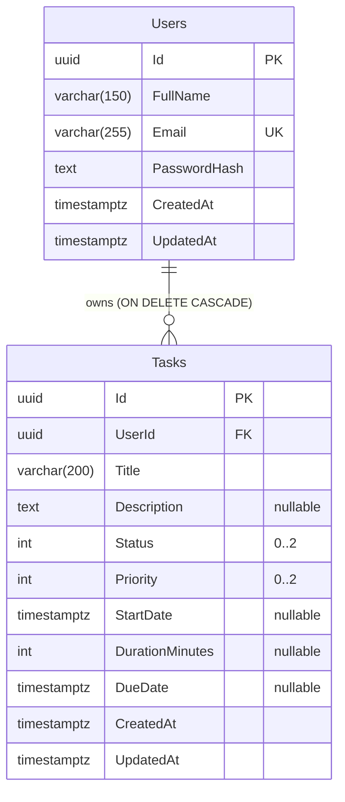

# Database Schema

PostgreSQL 16, EF Core Code First, Npgsql. Không thêm bảng ngoài `Users` và `Tasks` (chưa có nhu cầu nghiệp vụ).

## ERD

## Users

| Cột | Kiểu | Null | Ghi chú |
|---|---|---|---|
| Id | uuid | NOT NULL | PK, sinh ở ứng dụng (`Guid.CreateVersion7()`) để index tuần tự |
| FullName | varchar(150) | NOT NULL | |
| Email | varchar(255) | NOT NULL | Lưu chữ thường đã trim (AC-01) |
| PasswordHash | text | NOT NULL | Hash PBKDF2, chuỗi dài không cố định nên dùng `text` |
| CreatedAt | timestamptz | NOT NULL | UTC |
| UpdatedAt | timestamptz | NOT NULL | UTC |

- `UX_Users_Email`: unique index trên `Email`.
- Chọn lưu email chữ thường thay vì extension `citext` để không phụ thuộc extension và giữ migration thuần.

## Tasks

| Cột | Kiểu | Null | Ghi chú |
|---|---|---|---|
| Id | uuid | NOT NULL | PK, `Guid.CreateVersion7()` |
| UserId | uuid | NOT NULL | FK → Users(Id) `ON DELETE CASCADE` |
| Title | varchar(200) | NOT NULL | |
| Description | text | NULL | Giới hạn 5000 ký tự do Domain thực thi |
| Status | integer | NOT NULL | `TaskItemStatus` |
| Priority | integer | NOT NULL | `TaskPriority` |
| StartDate | timestamptz | NULL | Có cả giờ (bắt đầu khối giờ) |
| DurationMinutes | integer | NULL | Thời lượng phút, 1..1440 (migration `AddTaskDuration`) |
| DueDate | timestamptz | NULL | |
| CreatedAt | timestamptz | NOT NULL | UTC |
| UpdatedAt | timestamptz | NOT NULL | UTC |

Không đặt giá trị mặc định ở cột: mặc định Todo/Medium (BR-04, BR-05) do Domain gán khi tạo, nên có đúng một nguồn sự thật. Với enum, mặc định ở DB còn gây nhập nhằng vì giá trị 0 trùng giá trị mặc định của CLR.

Tên bảng trong DB là `Tasks`; tên entity trong code là `TaskItem` để không đụng `System.Threading.Tasks.Task`.

### Check constraint (lớp bảo vệ thứ hai, quy tắc chính nằm ở Domain)

| Tên | Biểu thức |
|---|---|
| `CK_Tasks_Status` | `"Status" IN (0, 1, 2)` |
| `CK_Tasks_Priority` | `"Priority" IN (0, 1, 2)` |
| `CK_Tasks_DurationMinutes` | `"DurationMinutes" IS NULL OR "DurationMinutes" BETWEEN 1 AND 1440` |
| `CK_Tasks_StartDate_LE_DueDate` | `"StartDate" IS NULL OR "DueDate" IS NULL OR "StartDate" <= "DueDate"` |

### Enum mapping

| Enum | Giá trị | Lý do thứ tự |
|---|---|---|
| `TaskItemStatus` | Todo=0, InProgress=1, Completed=2 | Thứ tự tiến độ |
| `TaskPriority` | Low=0, Medium=1, High=2 | Sắp xếp theo số cho đúng thứ tự ưu tiên |

EF Core: `HasConversion<int>()` tường minh. Giá trị số **không bao giờ đổi** sau khi phát hành. API tuần tự hóa dạng chuỗi (`JsonStringEnumConverter`).

## Index cho Tasks

Mọi truy vấn đều lọc theo `UserId` trước, nên mọi index bắt đầu bằng `UserId` (cũng phục vụ FK).

| Index | Cột | Phục vụ |
|---|---|---|
| `IX_Tasks_UserId_CreatedAt` | (UserId, CreatedAt DESC) | Danh sách mặc định, sort theo ngày tạo |
| `IX_Tasks_UserId_StartDate` | (UserId, StartDate) | Lịch ngày: lọc và sắp theo giờ bắt đầu |
| `IX_Tasks_UserId_DueDate` | (UserId, DueDate) | Sort/lọc theo hạn, quá hạn, sắp đến hạn |
| `IX_Tasks_UserId_Status` | (UserId, Status) | Lọc trạng thái, đếm Dashboard |
| `IX_Tasks_UserId_UpdatedAt` | (UserId, UpdatedAt DESC) | Mới cập nhật |

- Không đánh index riêng cho Priority: chỉ 3 giá trị, tập dữ liệu mỗi user nhỏ; sort theo ưu tiên chạy trên phần đã lọc bởi `UserId`. Sẽ đo lại ở Phase 6, thêm nếu cần.
- Tìm theo tiêu đề dịch thành `lower("Title")` + `strpos(...) > 0` (EF Core `ToLower().Contains()`), không dùng được index B-tree. Với quy mô cá nhân là chấp nhận được; nếu cần mở rộng thì thêm `pg_trgm` GIN trên `lower("Title")` (ghi nhận là hướng nâng cấp, chưa làm). Chọn cách này thay cho `ILIKE` để Application không phụ thuộc Npgsql và không cần escape ký tự đặc biệt.

## Chính sách xóa
- `Tasks.UserId` FK `ON DELETE CASCADE`: xóa User thì xóa hết task, không có dữ liệu mồ côi. v1 không có API xóa tài khoản, quy tắc này là bảo vệ ở tầng DB.

## Thời gian
- Tất cả `timestamptz`. Entity dùng `DateTimeOffset` và luôn chuẩn hóa về UTC trước khi lưu (offset khác 0 sẽ bị Npgsql từ chối nên không thể lưu nhầm). Đọc lại luôn có offset `+00:00`. Thời gian hiện tại lấy qua `TimeProvider` để test được.

## Migration
- Công cụ: `dotnet-ef` dạng local tool (`dotnet-tools.json`), migration đặt trong `TaskManagement.Infrastructure/Persistence/Migrations`, startup project là API.
- Đặt tên: `YYYYMMDD_MoTaNgan` do EF tự thêm timestamp, phần tên mô tả (`InitialCreate`, `AddTaskIndexes`).
- Không sửa migration đã áp dụng; sửa schema bằng migration mới.
- Áp dụng migration: lệnh CLI tường minh trong môi trường dev; **không** tự `Migrate()` lúc khởi động ở Production. Integration test tự áp dụng migration lên container và kiểm tra model không lệch migration (`HasPendingModelChanges`).
- Migration hiện có: `InitialCreate` (Users, Tasks, 5 index, 3 check constraint, FK cascade).
